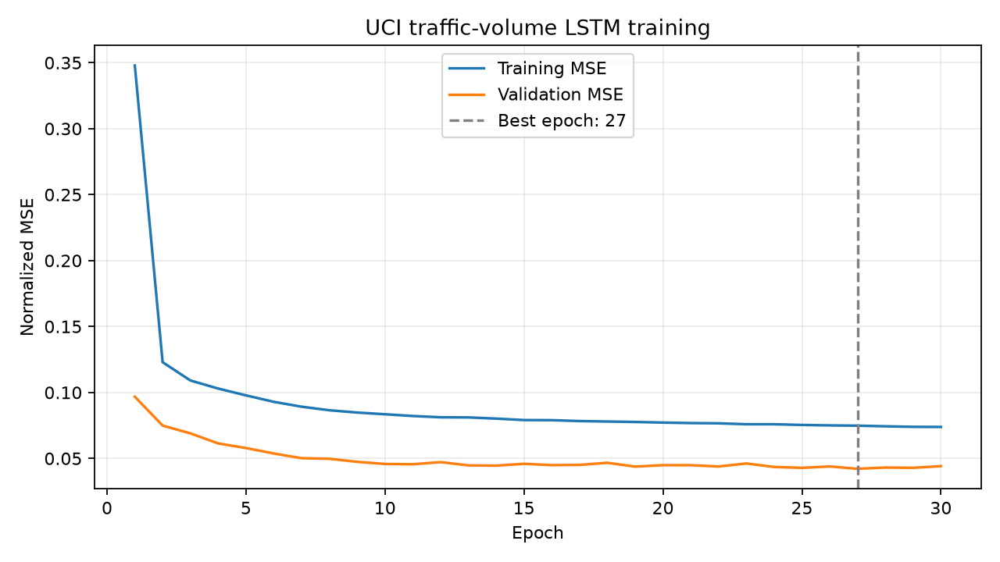
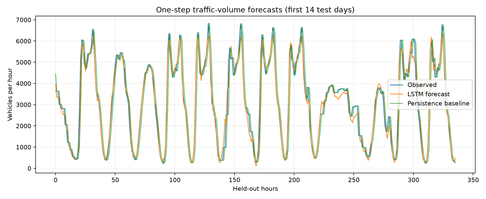
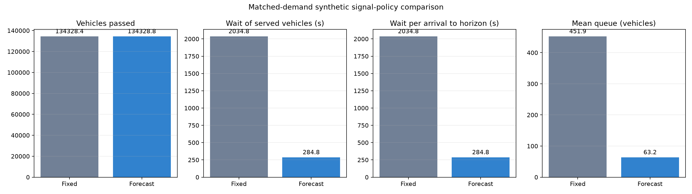

# AI-Based Traffic Congestion Prediction and Management

This project extends a Pygame four-way traffic simulation with a reproducible deep-learning experiment. A PyTorch Long Short-Term Memory (LSTM) network forecasts hourly traffic volume from historical observations. The project evaluates that forecast in a separate, explicitly synthetic intersection queue model and can also use it to adjust the original Pygame simulation.

The project has two distinct aims:

1. **Prediction:** train and test an LSTM that forecasts traffic volume one hour ahead.
2. **Management demonstration:** compare a fixed signal plan with a forecast-informed signal plan in a simplified, matched-demand queue simulation.

These are educational experiments, not a deployed traffic-control system. In particular, the dataset measures one highway counter, not a four-way junction. The approach-by-approach traffic split in the controller benchmark is synthetic. Read the limitations below before interpreting the results as evidence about real roads.

## Contents

- [Project overview](#project-overview)
- [Deep-learning model](#deep-learning-model)
- [Dataset](#dataset)
- [Install and run](#install-and-run)
- [Train and evaluate the LSTM](#train-and-evaluate-the-lstm)
- [Compare the signal policies](#compare-the-signal-policies)
- [Run the Pygame simulation](#run-the-pygame-simulation)
- [Results and how to interpret them](#results-and-how-to-interpret-them)
- [Files and generated outputs](#files-and-generated-outputs)
- [Limitations and future work](#limitations-and-future-work)
- [Dataset citation and license](#dataset-citation-and-license)

## Project overview

The project workflow is:

1. Download and validate the UCI traffic-volume dataset.
2. Prepare chronological sequences: 24 past hourly readings are used to predict the next reading.
3. Train an LSTM using the training portion, choose the checkpoint with the best validation loss, and measure its predictions on a later held-out test period.
4. Compare LSTM predictions with a simple persistence baseline that predicts that the next hour will equal the current hour.
5. Feed the LSTM predictions to a headless queue benchmark, which compares fixed and forecast-informed signal timing under identical arrivals.
6. Optionally run the original Pygame intersection visualization with its default queue timing or a forecast-adjusted queue timing.

The LSTM prediction metrics and queue benchmark results answer different questions. Prediction metrics measure how closely a model forecasts the real dataset's hourly highway volume. Queue metrics describe the behavior of the project's synthetic four-approach model under its assumptions. Better prediction on the held-out highway data does not by itself prove a real intersection would have less congestion.

The original Pygame simulation generates vehicles synthetically. It does not detect vehicles from camera images or learn from the displayed cars. The forecast mode is a demonstration of connecting an hourly traffic-volume forecast to signal timing.

## Deep-learning model

### What the model predicts

The model is a **one-step, univariate time-series forecaster**:

- **Input feature:** `traffic_volume`, measured in vehicles per hour.
- **Input window:** the previous 24 hourly observations.
- **Target:** the next hourly traffic-volume observation.
- **Forecast horizon:** one hour.

For example, the model takes readings for hours *t-23* through *t* and predicts the traffic volume at hour *t+1*. It does not forecast separate intersection approaches, vehicle classes, turning movements, or signal states.

### Why use an LSTM?

An LSTM is a type of recurrent neural network designed for ordered sequences. It processes the observations in time order and maintains a hidden state that can carry information from earlier steps in the input window. Its learned gates control which information to retain, update, and expose. The final hidden state for the 24-hour input sequence is passed to a linear layer that produces one numeric forecast.

The architecture in `traffic_ai.py` is:

```text
24 hourly values (one feature)
          |
          v
1-layer LSTM (32 hidden units)
          |
          v
Linear layer (32 -> 1)
          |
          v
Forecast for the next hour
```

The network has **4,513 trainable parameters**. This is a compact regression model; it does not classify congestion levels or directly choose an individual signal phase.

### Input preparation and time-based splits

The dataset is kept in chronological order and split by target time:

- **70% training**
- **15% validation**
- **15% test**

The training portion is used to calculate the mean and standard deviation for z-score normalization. Those same training-only values are used to normalize validation and test inputs and to restore forecasts to vehicles/hour. This avoids using future validation/test statistics to scale the training data.

Each example is a sliding window of 24 readings and its following reading. The model learns from the training windows. Validation loss is used to select the best checkpoint and control early stopping. The test partition is held out for the final reported forecast metrics; it is not used to select the model.

### Training configuration

| Hyperparameter / setting | Value |
|---|---:|
| Framework | PyTorch |
| Network | One LSTM layer followed by a linear regression output |
| Input features | 1 (`traffic_volume`) |
| Sequence length | 24 hourly observations |
| Forecast horizon | 1 hour |
| LSTM hidden units | 32 |
| Trainable parameters | 4,513 |
| Normalization | Z-score; mean and standard deviation from training data only |
| Loss function | Mean squared error (MSE) |
| Optimizer | Adam |
| Learning rate | 0.001 |
| Batch size | 128 |
| Maximum epochs | 30 |
| Early-stopping patience | 5 epochs without validation improvement |
| Random seed | 42 |
| Training device in the recorded run | CPU |

During training, gradients are calculated from the MSE loss for each shuffled training batch, and Adam updates the network weights. After each epoch, validation MSE is measured. The weights with the lowest validation MSE are retained. The final test metrics are calculated after restoring predictions to their original vehicles/hour scale.

### Metrics

- **MAE (Mean Absolute Error):** the average absolute difference between the predicted and observed volume, in vehicles/hour. Lower is better.
- **RMSE (Root Mean Squared Error):** the square root of the average squared error, in vehicles/hour. It penalizes large misses more strongly than MAE. Lower is better.
- **WAPE (Weighted Absolute Percentage Error):** total absolute error divided by total observed volume, expressed as a percentage. Lower is better.
- **Persistence baseline:** predicts the next reading as the most recent reading. It is a useful simple reference: the LSTM should be compared with it, not just judged by whether its loss falls during training.

## Dataset

The model is trained on the **Metro Interstate Traffic Volume** dataset from the [UCI Machine Learning Repository](https://archive.ics.uci.edu/dataset/492/metro+interstate+traffic+volume).

| Dataset detail | Description |
|---|---|
| Collection site | Westbound I-94 ATR station 301, Minneapolis–St Paul |
| Number of records | 48,204 hourly observations |
| Recorded period | October 2012 through September 2018 |
| Target used here | `traffic_volume` (vehicles per hour) |
| Other dataset fields | `holiday`, `temp`, `rain_1h`, `snow_1h`, `clouds_all`, `weather_main`, and `weather_description`; this model uses none of these features |
| Download behavior | Downloaded automatically on the first training run and reused from `data/` afterward |

The dataset is **not intersection data**: it has one highway-counter volume series and does not provide four approaches, turning counts, queues, or signal phases. Therefore, the benchmark's four-direction split is generated synthetically and must not be presented as observed intersection demand.

The source dataset ends in 2018. The GUI's optional forecast uses the last 24 records in that historical CSV to demonstrate inference; it is not a forecast of current traffic.

## Install and run

Use Python 3.10 or newer. Open PowerShell, change to the project folder, and create/install the environment. Replace the example path with the folder where you cloned this repository:

```powershell
cd "C:\path\to\Traffic-Management-Using-AI"
python -m venv .venv
.\.venv\Scripts\Activate.ps1
python -m pip install --upgrade pip
python -m pip install -r requirements.txt
```

If PowerShell does not allow environment activation, call the virtual environment's interpreter directly:

```powershell
.\.venv\Scripts\python.exe -m pip install -r requirements.txt
```

Run all commands below from the project directory so that relative paths to `data/`, `artifacts/`, `reports/`, and the Pygame image assets resolve correctly.

## Train and evaluate the LSTM

```powershell
python train_lstm.py
```

On the first run, the script downloads the official UCI archive, extracts the CSV to `data/`, validates the required columns and chronological order, and trains the model. It saves the selected checkpoint, test metrics, per-timestamp test predictions, and plots. Subsequent runs reuse the downloaded CSV and retrain the model with the configured seed.

Optional arguments:

```powershell
python train_lstm.py --help
python train_lstm.py --data-dir data --artifact-dir artifacts --report-dir reports
```

## Compare the signal policies

After training, run:

```powershell
python run_comparison.py
```

The default experiment uses the first 168 hours of the held-out test period and five deterministic synthetic directional scenarios. For each scenario, both policies receive the same hourly arrivals and direction profile:

1. **Fixed-time baseline:** 27 seconds green for each approach, then 3 seconds clearance per phase.
2. **Forecast-informed policy:** the LSTM's next-hour total-volume forecast is scaled to synthetic intersection demand. A bounded Webster-style calculation chooses a cycle length from 60 to 180 seconds; green time is allocated across approaches using the synthetic directional split, with each green phase bounded from 8 to 90 seconds.

Specifically, the benchmark first scales forecast volume by 0.25, distributes that synthetic demand using the directional shares, and calculates the critical flow ratio `Y` as total approach demand divided by the assumed saturation flow of 1,800 vehicles/hour. `Y` is capped at 0.90. With lost time `L` set to 3 seconds per approach (12 seconds for four approaches), the cycle estimate is `C = (1.5 × L + 5) / (1 - Y)`, rounded and then bounded to 60–180 seconds. The lost time is reserved for clearance; the remaining cycle time is allocated as green, proportional to the synthetic approach demands within the 8–90 second bounds.

The queue model simulates arrivals and signal service at one-second resolution. Its assumed saturation service rate is 1,800 vehicles/hour per approach (one vehicle per two green seconds), and the observed highway volume is scaled to 25% to make a smaller synthetic intersection demand. These assumptions are fixed for the benchmark and are not calibrated field measurements.

The comparison reports vehicles passed, wait among served vehicles, wait accumulated through the simulation horizon per arrival, mean/max queue, and vehicles remaining at the horizon. Wait accumulated to the horizon includes the wait so far of vehicles still queued; it is **not** an estimate of their eventual total wait. Inspect multiple measures and the per-scenario results rather than selecting only the most favorable metric.

Optional arguments:

```powershell
python run_comparison.py --help
python run_comparison.py --hours 168 --seeds 5 --output-dir reports
```

## Run the Pygame simulation

The original queue-based policy remains the default:

```powershell
python simulation.py
```

To run with the trained forecast adjustment:

```powershell
python simulation.py --policy forecast
```

Forecast mode requires both `data/Metro_Interstate_Traffic_Volume.csv` and `artifacts/traffic_lstm.pt`, which are created by the training command. It loads the most recent 24 historical volume readings, predicts the next hour, and multiplies the existing queue-based green-time estimate by the forecast-to-recent-average ratio, bounded from 0.5 to 1.5. The HUD identifies the active policy.

The Pygame forecast adjustment is a **visual demonstration**, distinct from the headless benchmark's bounded cycle calculation and synthetic approach allocation. The GUI's random vehicle generation is not driven by the UCI series, and its displayed traffic is not calibrated to the highway counter.

See the available command-line options with:

```powershell
python simulation.py --help
```

## Results and how to interpret them

The values below come from the recorded run with seed 42. The scripts can regenerate them; small differences may occur with different library versions or hardware.

### Forecast results on the held-out test period

| Metric | LSTM | Persistence baseline |
|---|---:|---:|
| MAE (vehicles/hour) | 267.3 | 485.8 |
| RMSE (vehicles/hour) | 397.1 | 740.2 |
| WAPE | 8.14% | 14.79% |

On this chronological test split, the LSTM reduced MAE by approximately **45.0%** and RMSE by approximately **46.4%** compared with predicting the previous hour. This indicates predictive value over that baseline for this dataset and test period. It does not establish accuracy at a different location or on recent traffic.





### Forecast-informed signal policy versus fixed-time policy

Mean values across five scenarios, each simulating 168 held-out hours:

| Queue-model measure | Fixed-time | Forecast-informed | Relative change |
|---|---:|---:|---:|
| Vehicles passed per scenario | 134,328.4 | 134,328.8 | +0.0003% |
| Mean wait of served vehicles | 2,034.8 s | 284.8 s | -86.0% |
| Wait per arrival through simulation horizon | 2,034.8 s | 284.8 s | -86.0% |
| Mean queue | 451.9 vehicles | 63.2 vehicles | -86.0% |
| Maximum queue | 1,617.6 vehicles | 374.2 vehicles | -76.9% |

In this synthetic queue model, forecast-informed timing substantially reduced the modeled waiting and queue measures, while throughput was effectively unchanged. The large improvement is **not a real-world impact estimate**: it depends on an artificially generated four-way split, simplified arrivals and service, chosen scaling/capacity assumptions, and the behavior of this queue model. A real traffic-management claim would require intersection-level, direction-specific data and validation in a calibrated traffic simulator or field study.



## Files and generated outputs

### Source files

| File | Purpose |
|---|---|
| `simulation.py` | Pygame intersection visualization; supports default `queue` and optional `forecast` policies |
| `traffic_ai.py` | UCI download/loading, chronological sequence preparation, LSTM definition, metrics, and inference |
| `train_lstm.py` | Training loop, early stopping, test evaluation, checkpoint saving, and forecast/training plots |
| `traffic_control.py` | Synthetic four-approach green allocation and second-resolution matched-demand queue model |
| `run_comparison.py` | Runs the fixed-versus-forecast benchmark and writes summary tables/plots |
| `tests/test_traffic_ai.py` | Unit tests for data preparation, model output, metrics, policy bounds, and reproducibility |
| `Charts/chart.py` | Displays the repository's older historical chart data; it is not generated by the new benchmark |
| `requirements.txt` | Python package requirements |

### Generated files

| Path | Generated by | Contents |
|---|---|---|
| `data/Metro_Interstate_Traffic_Volume.csv` | `train_lstm.py` | Downloaded UCI dataset |
| `artifacts/traffic_lstm.pt` | `train_lstm.py` | Model weights and normalization/configuration required for inference |
| `reports/training_metrics.json` | `train_lstm.py` | Dataset, architecture, training history, test and baseline metrics |
| `reports/test_predictions.csv` | `train_lstm.py` | Timestamped actuals, LSTM predictions, and persistence predictions |
| `reports/training_curves.png` | `train_lstm.py` | Training and validation MSE over epochs |
| `reports/forecast_vs_actual.png` | `train_lstm.py` | First 14 test days of observed, LSTM, and persistence values |
| `reports/policy_comparison.json` | `run_comparison.py` | Assumptions, per-scenario rows, averages, and relative changes |
| `reports/policy_comparison.csv` | `run_comparison.py` | Per-policy, per-seed benchmark metrics |
| `reports/policy_comparison.png` | `run_comparison.py` | Chart of the main policy comparison measures |

The dataset and model checkpoint are generated locally and excluded from version control. The reports are reproducible outputs; rerun the corresponding command to regenerate them.

## Tests

Run the unit tests from the project directory:

```powershell
python -m unittest discover -s tests -v
```

The tests cover chronological split boundaries, model output shape, metric calculations, dataset loading, signal green bounds, cycle bounds, deterministic policy runs, and matched-policy behavior. They do not prove that the synthetic benchmark predicts real-world outcomes.

## Limitations and future work

- The training data is hourly, from one westbound highway counter, and ends in 2018. It is not current data or intersection-level data.
- The model is univariate and predicts one hour ahead. It does not use weather, calendar features, camera images, lane counts, or live sensor feeds, even though some of those fields are available in the source dataset.
- The benchmark invents the directional distribution and scales the observed volume. Its results are sensitive to those modeling choices and should be treated as a controlled demonstration.
- The Pygame vehicle generator is random and is not trained or calibrated from the UCI dataset.
- The GUI's forecast adjustment is bounded, simple, and illustrative; it is not a safety-certified traffic controller. It does not control real traffic signals.
- A stronger real-world study would use recent intersection-specific approach/turn counts, calibrated arrival and saturation-flow models, multiple time-based test periods, comparisons with established control strategies, uncertainty analysis, and independent validation.

## Dataset citation and license

The dataset is distributed under **CC BY 4.0**. Please retain attribution when using or redistributing it:

> Hogue, J. (2019). *Metro Interstate Traffic Volume* [Dataset]. UCI Machine Learning Repository. https://doi.org/10.24432/C5X60B.

Dataset page: <https://archive.ics.uci.edu/dataset/492/metro+interstate+traffic+volume>
